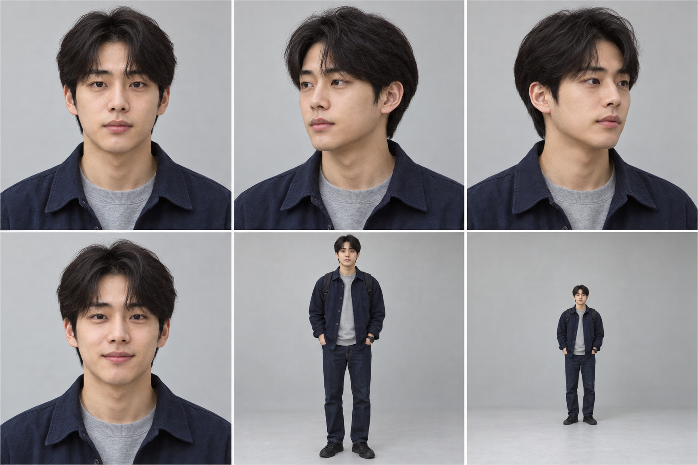
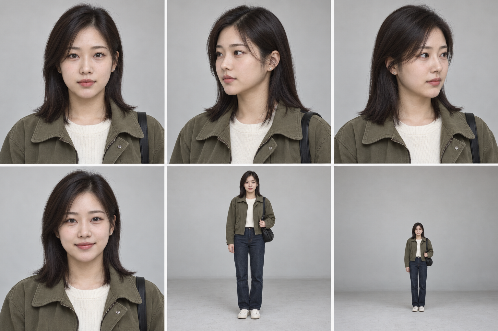
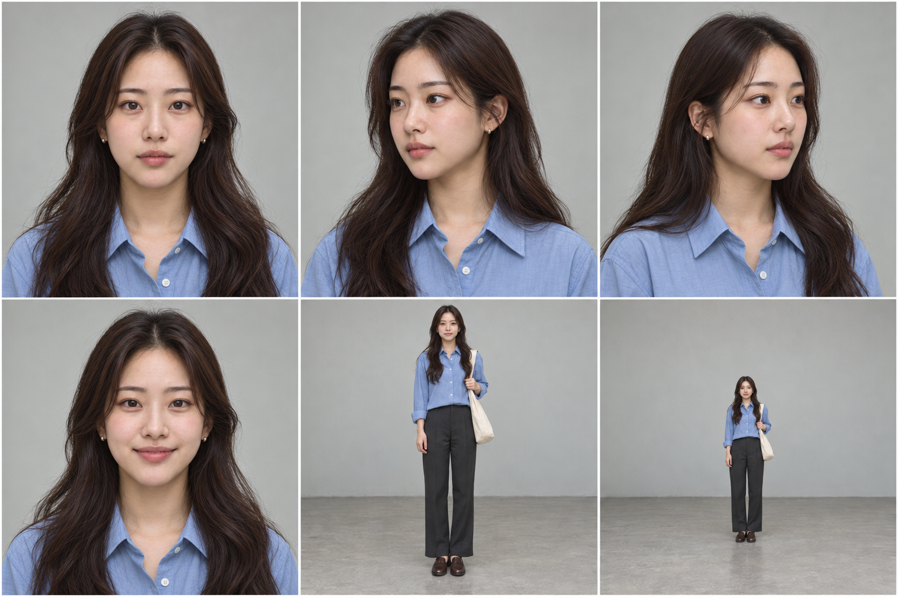
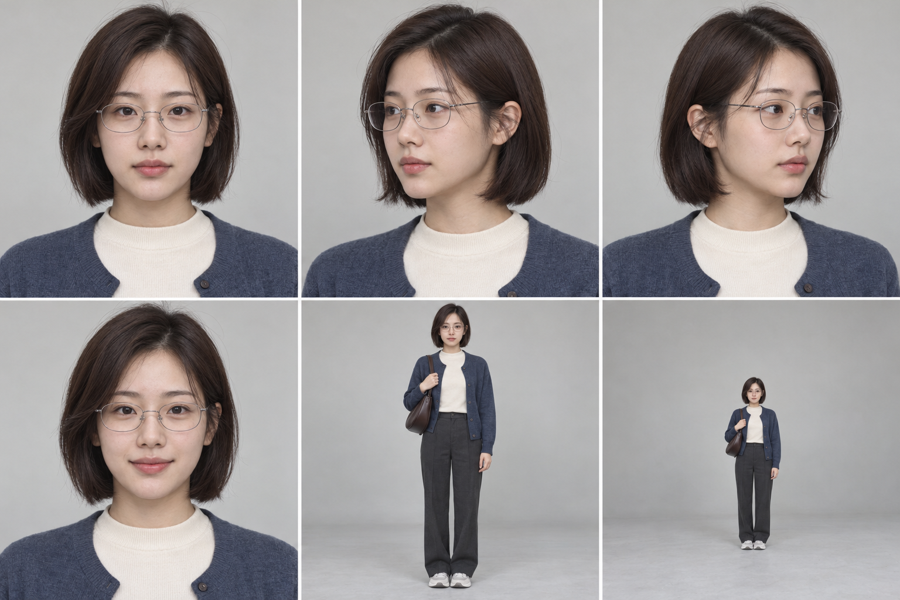

# 교차점 — 캐릭터 바이블 v0.1

> 상태: 2026-10-12 사용자 승인·확정  
> 설정 원본: `GameDesign.md`  
> 데이터 연속성 기준: `교차점_초반데이터_제작패킷_v0.3.md`  
> 용도: 이후 모든 메시지, 사진, 스크린샷, 프로필, 편집본 제작의 인물 기준

## 0. 적용 원칙

- 서지훈(A), 윤서하(B), 정유진(C), 강나린(D)은 아래 이름과 나이를 정식 기준으로 사용한다.
- 캐릭터시트는 **얼굴과 신체 비율의 최우선 시각 기준**이다. 이후 이미지는 텍스트만으로 새로 생성하지 않고 해당 인물의 시트를 정체성 참조 이미지로 사용한다.
- 캐릭터시트의 옷은 대표 착장이다. 얼굴 골격, 눈·눈썹, 코·입, 헤어라인, 머리 길이·질감, 키·체형 비율은 고정하되 장면별 의상과 머리 묶음 여부는 이 문서 범위 안에서 바꿀 수 있다.
- 외모로 선악이나 피해 여부를 암시하지 않는다. 서지훈과 윤서하는 모두 평범한 대학생으로 보이고, 정유진과 강나린도 전형적인 피해자 이미지로 연출하지 않는다.
- 점, 흉터, 문신, 특이한 눈 색처럼 한 장만 보고 정답을 맞히는 표식은 사용하지 않는다.
- 실제 사진 에셋을 만들 때 자동 얼굴 일치 표시, 이름표, 작가용 A/B/C/D/E 표기를 화면에 노출하지 않는다.
- 아래 항목은 계속 미확정으로 보호한다.
  - 서지훈이 윤서하를 처음 후보로 좁힌 정확한 계기
  - 사건 당일 `찾았다`와 함께 보낸 마지막 캡처의 정확한 내용
  - 강나린의 구체적인 피해 내용과 수위
  - A13의 최종 수신인
  - 폐상가 내부 대화와 누가 먼저 휴대전화를 잡거나 몸싸움을 시작했는지

## 1. 인물 공통표

| 역할 | 정식 이름 | 사건일 기준 만 나이 | 신분·관계 |
| --- | --- | ---: | --- |
| A | 서지훈 | 23세 | 학부 재학생. 정유진의 오래된 동네 친구이자 같은 대학의 가까운 친구 |
| B | 윤서하 | 22세 | 지역권 대학 학부 재학생. A/C와 같은 대학인지는 미정 |
| C | 정유진 | 23세 | 서지훈과 같은 대학의 학부 재학생. 윤서하와 패션 커뮤니티에서 만나 친해짐 |
| D | 강나린 | 21세 | 지역권 대학 학부 재학생. 윤서하와 같은 패션 커뮤니티·소모임에서 알게 된 가벼운 지인 |
| E | 이름 미상 | 미정 | 얼굴 전체를 보여주지 않는 세 번째 피해자 계열 인물. 화면에 E 호칭을 노출하지 않음 |

학년, 전공, 통학·자취 여부, 구체적인 경제상황은 현재 사건에 필요하지 않으므로 확정하지 않는다.

---

## 2. 서지훈(A)



### 2-1. 인물 핵심

- **첫인상:** 말수가 적고 생활이 단정한 평범한 학생. 다소 무뚝뚝하지만 처음부터 음침하거나 위협적으로 보이지 않는다.
- **실제 성격:** 가까운 사람의 문제를 자기 일처럼 붙들고, 한 번 책임졌다고 느낀 일은 쉽게 놓지 않는다. 패턴을 찾고 기록을 누적하는 집중력과 지속력이 강하다.
- **장점:** 책임감, 충성심, 관찰력, 자료 정리 능력, 끝까지 파고드는 끈기.
- **결점:** 확신이 생기면 타인의 중단 요구와 사생활 경계를 무시한다. 목적을 설명하지 않은 채 상대가 이미 알고 있다고 단정하고 압박한다. 결과적으로 도촬, 미행, 신상 추적과 외진 장소 호출까지 선을 넘는다.
- **감정 표현:** 감정을 직접 이름 붙이지 않고 행동과 짧은 문장으로 대신한다. 걱정은 `내가 할게`, 분노는 `계속`, `언제까지`, 불안은 확인과 통제 요구로 나타난다.
- **거리두기:** 설명을 줄이고 `됐어`, `나중에 말할게`로 대화를 닫는다.
- **스트레스 반응:** 문장이 짧아지고 같은 요구를 반복한다. 상대의 침묵이나 거절을 회피로 해석해 압박 수위를 높인다.
- **혼동 방지 핵심:** 무뚝뚝한 해결 중심 말투, 부드러운 턱선과 일자 눈썹, 6:4 약한 곱슬머리, 네이비·차콜 계열의 평범한 옷.

### 2-2. 말투 기준

- 한 문장 또는 두 개의 짧은 말풍선.
- 종결은 `-어`, `-게`, `-하자`, `-하면 돼`, `-할 거야`가 중심이다.
- 맞춤법과 띄어쓰기는 대체로 정확하지만 주어와 목적어를 자주 생략한다.
- 마침표와 물음표는 적게 쓰고 줄바꿈으로 생각을 분리한다. 말줄임표는 쓰지 않는다.
- 사건 관련 대화에서 이모티콘, `ㅋㅋ`, `ㅎㅎ`는 사용하지 않는다. 완전히 무관한 가까운 친구 일상 대화에서 `ㅋㅋ` 한 번 정도만 허용한다.
- 결론과 요구는 나눠 보내지만, 이유를 여러 메시지로 친절하게 설명하지는 않는다.
- 회피할 때는 `됐어`, `나중에 말할게`처럼 대화를 닫는다.
- 화났을 때는 수사적 질문과 `계속`, `그냥`, `언제까지`가 늘어난다.
- 두려울 때도 `무섭다`고 말하기보다 확인·통제·대면 요구로 바뀐다.
- 친한 사람에게는 짧은 반말, 일반적인 낯선 사람에게는 짧고 사무적인 존댓말을 쓴다. 윤서하에게는 기존 원문대로 반말을 쓰되 두 사람의 과거 친분을 새로 만들지 않는다.

말투 검수용 신규 예문:

- `응 끝나고 갈게`
- `그냥 내가 할게 / 너는 쉬어`
- `됐어 / 나중에 말할게`
- `몇 번을 말해야 돼 / 그냥 확인만 하면 되잖아`

### 2-3. 외모 기준

- 얼굴형: 길지 않은 타원형. 턱선은 부드럽고 과하게 날카롭지 않다.
- 눈·눈썹: 가로로 반듯한 중간 크기 눈, 얕은 속쌍꺼풀, 숱이 보통인 일자 눈썹.
- 코·입: 곧은 중간 높이 코, 아랫입술이 약간 더 도톰한 균형 잡힌 입.
- 피부: 뉴트럴 톤. 모공과 옅은 면도 자국을 지우지 않은 자연스러운 표현.
- 머리: 검은색, 귀를 일부 덮는 중간 길이, 6:4 가르마, 약한 자연 곱슬.
- 체형·키 인상: 약 176cm, 평균 체형과 평균 어깨.
- 평소 표정: 생각에 잠긴 평범한 무표정. 강한 응시나 고개를 숙인 위협적 자세를 기본값으로 쓰지 않는다.
- 화장: 없음.
- 반복 소품: 검은 캔버스 백팩, 단순한 검은 시계.
- 옷 실루엣: 레귤러핏 셔츠·스웨트셔츠·짧은 재킷, 스트레이트 팬츠.
- 기본 팔레트: 네이비, 차콜, 올리브, 데님, 오프화이트.

### 2-4. 사진 사용

- T02 가족사진과 필요한 경우 A-F06 일상 단체사진에서만 얼굴을 반복한다.
- 사건 관련 기록에서는 본인이 카메라 뒤에 있는 경우가 많으므로 얼굴 사진을 추가하지 않는다.
- T02 가족사진은 **서지훈과 부모 2명의 3인 가족 식사사진**으로 정한다. 부모의 상세 인물 설정은 만들지 않는다.
- T02 권장 착장: 연한 파란 옥스퍼드 셔츠 안에 흰 티, 진청 데님, 검은 시계.
- A-F06을 정식 사용하면 차콜 후디와 네이비 오버셔츠 정도로 변형하되 얼굴 골격과 머리는 시트에 맞춘다.
- 가족사진에서 혼자 떨어져 있거나 카메라를 노려보는 식으로 사건을 예고하지 않는다.

---

## 3. 윤서하(B)



### 3-1. 인물 핵심

- **첫인상:** 조용하고 성실하며 상대에 맞춰 무리 없이 대화하는 평범한 학생.
- **실제 성격:** 상대의 관심사와 거리감을 빠르게 읽고 관계를 조율한다. 평범한 일상에서 보이는 호감과 서지훈에게 느끼는 공포는 실제 감정이다. 동시에 삶의 영역을 분리하고, 타인의 신뢰를 자료 접근과 통제의 수단으로 바꾸며 피해를 합리화한다.
- **장점:** 관찰력, 사회적 적응력, 정돈된 생활, 상대의 취향을 기억하는 능력.
- **결점:** 관계를 도구로 사용할 수 있으며 자신의 행동이 상대에게 남기는 결과를 분리해 생각한다. 실제 신원과 익명 활동을 철저히 구분한다.
- **감정 표현:** 평상시에는 짧은 호응과 부드러운 평가로 표현한다. 불편하면 공개하는 정보를 줄이고, 두려움이 커지면 상황 보고 → 안전 행동 → 직접적인 거절 → 짧은 답과 침묵으로 이동한다.
- **거리두기:** 관계별 정보를 분리하고 필요한 만큼만 공유한다. 차갑게 무시하기보다 답변의 범위를 좁힌다.
- **스트레스 반응:** 시간·장소를 구체적으로 말하고 기록을 남기며, SNS 공개범위 변경·메시지 알림 끄기·동행 요청·귀가경로 변경 같은 실제 행동으로 옮긴다.
- **혼동 방지 핵심:** 세 층위로 갈리는 말투, 쇄골 길이의 곧은 머리, 부드러운 볼 윤곽, 작은 은색 귀걸이와 검은 나일론 숄더백.

### 3-2. 평상시 말투

- 한두 문장 정도이며 `-것 같아`, `-보여`, `-할게`, `-가자`를 자연스럽게 쓴다.
- 맞춤법과 띄어쓰기는 안정적이다.
- 마침표는 드물고 질문은 짧게 보낸다.
- 가까운 친구와 가족에게 `ㅎㅎ`를 드물게 사용할 수 있지만 고정 대화와 공포 관련 대화에는 넣지 않는다.
- 오래 설명하기보다 한두 개의 말풍선으로 나눠 보낸다.
- 회피할 때는 질문으로 되받거나 `몰라`라고 답한다.
- 일반적인 낯선 사람에게는 정중하고 얕은 존댓말을 사용한다.

말투 검수용 신규 예문:

- `오늘은 조금 늦을 것 같아 / 끝나면 연락할게`
- `응 나도 그게 더 나아 보여`
- `싫어 / 더 연락하지 마`
- `오늘은 같이 가줄 수 있냐?`

### 3-3. 서지훈에게 쓰는 방어 말투

- 첫 답은 짧은 질문, 이후 부정·거절·경계로 이어진다.
- 한 단어 답변 → 직접적인 중단 요구 → 두려움의 명시 → 침묵 순서가 자연스럽다.
- 감정이 커져도 자기 입장을 장황하게 해명하지 않는다.
- `…`는 사건 당일처럼 궁지에 몰린 순간에만 사용한다.
- 기존 A03/B03/A12/B15 원문은 한 글자도 고치지 않는다.

### 3-4. 익명 계정 말투

- 감정이 드러나지 않는 게시판식 문체로 위장한다.
- 주어를 생략하고 짧은 단위와 명사형 종결을 사용한다.
- 일상 말투의 `-보여`, `-할게`, `ㅎㅎ`는 쓰지 않는다.
- 일상 말투와 공유하는 약한 습관은 두 개만 둔다.
  1. 긴 설명을 한 번에 쓰지 않고 짧은 단위로 끊음.
  2. `오늘`, `지난번`, `이번엔`처럼 시간 표현을 문장 앞에 두는 경향.
- 동일한 오타, 고유 유행어, 같은 이모티콘, 완전히 같은 줄바꿈 패턴은 금지한다.

말투 검수용 신규 예문:

- `오늘 확인한 것만 정리`
- `사진은 일부만`
- `시간대는 지난번과 비슷함`
- `나머지는 나중에`

위 문장들은 음성 가이드일 뿐 새 사건 기록이나 익명 게시물 원문이 아니다.

### 3-5. 외모 기준

- 얼굴형: 볼 폭이 약간 있는 부드러운 타원형.
- 눈·눈썹: 길지 않은 아몬드형 눈, 낮은 쌍꺼풀선, 끝이 아주 조금 올라가는 자연 눈썹.
- 코·입: 중간 크기의 곧은 코, 균형 잡힌 입술과 둥근 입꼬리.
- 피부: 웜 뉴트럴 톤. 과도한 미백과 도자기 피부 표현 금지.
- 머리: 검정에 가까운 짙은 갈색, 쇄골 길이의 곧은 머리, 6:4 가르마, 끝부분만 안쪽으로 정리.
- 체형·키 인상: 약 163cm, 평범하고 균형 잡힌 체형.
- 평소 표정: 긴장 없는 중립 표정과 작고 자연스러운 웃음.
- 화장: 얇은 베이스, 정리된 눈썹, 채도 낮은 로즈 립.
- 반복 소품: 작은 은색 스터드 귀걸이, 검은 나일론 숄더백.
- 옷 실루엣: 짧은 재킷·카디건, 단정한 니트, 스트레이트 데님·슬랙스.
- 기본 팔레트: 아이보리, 회청색, 올리브, 진청, 탁한 와인색.

### 3-6. A01/B01 사진 연속성

- A01의 18장은 6일에 걸쳐 촬영하되 같은 날짜 세 장의 옷·겉옷·가방·신발·액세서리·머리를 완전히 동일하게 유지한다.
- A01을 장면마다 새 인물로 생성하지 않는다. 윤서하 캐릭터시트를 정체성 참조 이미지로 사용하고 촬영 거리·각도·압축·초점만 바꾼다.
- 18장 중 최소 4장은 얼굴 일부를 비교할 수 있게 하고, D-5 마지막 사진은 먼 거리에서도 3/4 얼굴을 알아볼 수 있게 한다.
- B01은 SNS 프로필이 아니라 D-5 로컬 갤러리의 일상사진이다.
- D-5의 A01-16~18, B01, 같은 날 친구 단체사진은 얼굴뿐 아니라 전체 착장이 완전히 같아야 한다.

| 날짜 | 상의 | 하의 | 겉옷 | 신발 | 가방·액세서리 | 머리 | 동일 자료 |
| --- | --- | --- | --- | --- | --- | --- | --- |
| D-21 | 밝은 회색 스웨트셔츠 | 진청 스트레이트 데님 | 네이비 나일론 바람막이 | 흰색·회색 러닝화 | 검은 백팩, 은색 스터드 | 낮게 묶음 | A01-01~03, B02-M1 후문 인지 |
| D-18 | 흰색 골지 티 | 검은 스트레이트 슬랙스 | 탁한 녹색 카디건 | 검은 로퍼 | 짙은 갈색 숄더백 | 자연스럽게 내림 | A01-04~06 |
| D-15 | 연한 파란 줄무늬 셔츠 | 중청 데님 | 모래색 코튼 재킷 | 크림색 스니커즈 | 크림 캔버스 토트 | 내림, 양쪽 귀 일부 노출 | A01-07~09 |
| D-12 | 오트밀 얇은 니트 | 차콜 슬랙스 | 짙은 회색 집업 후디 | 검은 러닝화 | 검은 나일론 숄더백 | 낮게 묶음 | A01-10~12, B02-M2 버스정류장 |
| D-9 | 탁한 와인색 긴팔 티 | 검은 데님 | 연회색 후드 재킷 | 회색 스니커즈 | 검은 백팩 | 내림, 왼쪽 귀 뒤로 넘김 | A01-13~15 |
| D-5 | 아이보리 크루넥 니트 | 진청 스트레이트 데님 | 탁한 올리브색 짧은 필드 재킷 | 오프화이트 로우 스니커즈 | 검은 나일론 숄더백, 은색 스터드 | 내림, 6:4 가르마, 왼쪽 귀 뒤로 넘김 | A01-16~18, B01, 같은 날 친구사진 |

정확한 월과 날씨는 정하지 않고 얇은 재킷·니트가 가능한 간절기만 시각 기준으로 사용한다.

---

## 4. 정유진(C)



### 4-1. 인물 핵심

- **첫인상:** 친근하고 표현이 자연스러우며 옷과 일상 이야기를 편하게 나누는 학생.
- **실제 성격:** 사람을 믿으면 맥락과 감정을 비교적 솔직하게 공유한다. 자기 피해가 계속 기록되고 재검토되는 것 자체를 견디기 어려워하며, 결국 자신의 이야기와 자료를 지울 권리를 분명하게 요구한다.
- **장점:** 따뜻함, 솔직함, 관계를 유지하려는 인내, 자신의 의사를 언어화하는 힘.
- **결점:** 불편을 한동안 참다가 한계에 이르면 대화 자체를 닫는다. 이는 피해 책임이 아니라 관계 방식상의 특성으로만 다룬다.
- **감정 표현:** 처음에는 구체적인 상황과 이유를 설명한다. 반복 노출되면 `그 얘기`, `싫다고`, `그만하자`처럼 주제를 닫는다.
- **거리두기:** 잠수보다 명시적인 중단 요청을 택한다.
- **스트레스 반응:** 초기에는 사실을 구체적으로 보고하지만 시간이 지나면 설명을 줄이고 같은 경계를 반복한다.
- **혼동 방지 핵심:** 비교적 완전한 문장과 직접적인 경계 표현, 긴 느슨한 웨이브, 좁은 하관, 표정이 잘 드러나는 눈썹.

### 4-2. 말투 기준

- 평상시 한두 문장, 설명이 필요할 때 최대 세 문장.
- `-어`, `-했어`, `-같아`, `-하자`를 사용하고 경계할 때 `-싫어`, `-그만하자`로 명확해진다.
- 네 명 중 완전한 문장을 가장 자주 사용한다.
- 마침표로 생각을 구분하고 질문에는 물음표를 자연스럽게 사용한다. 말줄임표는 거의 쓰지 않는다.
- 평범한 일상에서 `ㅎㅎ`를 가끔 사용할 수 있지만 피해·삭제 관련 대화에는 사용하지 않는다.
- 회피할 때는 `지금은 그 얘기 하고 싶지 않아`처럼 주제를 직접 닫는다.
- 화났을 때 이유를 한 번 말한 뒤 중단을 요구한다.
- 친한 사람에게는 감정이 드러나는 반말, 낯선 사람에게는 부드럽지만 완전한 존댓말을 쓴다.

말투 검수용 신규 예문:

- `이건 어때? 실제로 보면 색이 조금 달라`
- `끝나면 연락해 / 늦으면 먼저 갈게`
- `지금은 그 얘기 하고 싶지 않아`
- `싫다고 했잖아 / 여기서 그만해`

### 4-3. 외모 기준

- 얼굴형: 윤서하보다 조금 긴 타원형. 아래쪽 얼굴이 좁지만 뾰족하지 않다.
- 눈·눈썹: 조금 더 둥근 아몬드형 눈, 낮고 곧은 눈썹. 표정에 따른 눈썹 움직임이 잘 보인다.
- 코·입: 끝이 둥근 곧은 코, 웃을 때 입술 폭이 넓어지는 형태.
- 피부: 웜 뉴트럴 톤. 뺨의 자연스러운 붉은기를 유지한다.
- 머리: 짙은 갈색, 견갑골 아래 길이, 느슨한 큰 S컬, 5:5에 가까운 가르마.
- 체형·키 인상: 약 162cm, 평균 체형.
- 평소 표정: 반응이 얼굴에 잘 드러나며 웃을 때 눈가가 함께 움직인다.
- 화장: 자연스러운 피치 계열, 윤서하보다 아주 조금 밝은 립.
- 반복 소품: 작은 둥근 금속 귀걸이, 크림색 캔버스 토트.
- 옷 실루엣: 셔츠·부드러운 카디건·레이어드 상의, 스트레이트 팬츠.
- 기본 팔레트: 블루, 크림, 코코아, 회색, 탁한 살구색.

### 4-4. B05/B07/A06/B08 사진 계보

같은 원본 계열로 취급하는 자료는 `B05-01/B07 → B08 → c-post-01`이다. B05-02~06은 별도 일상사진이며 비슷한 사진으로 재생성하지 않는다.

#### 원본 `c-outfit-01`

- 세로 3:4 전신 거울 착장 사진.
- 파란 코튼 셔츠의 왼쪽 소매 바깥쪽에 작은 아이보리 자수.
- 거울 오른쪽 위에 짧은 사선 흠집.
- 휴대전화는 가슴 높이에 있어 얼굴 전체를 가리지 않는다.
- B04 첨부/B05-01은 채팅 압축 표시, B07은 갤러리 저장본이지만 구도와 내용은 동일하다.

#### B08 중간 편집본

- B07을 실제 원본으로 사용한다.
- 좌우 약 15%와 위·아래(무릎 아래)를 크롭해 4:5 상반신 중심 화면으로 바꾼다(실제 파일 `c-b08-01`: 896×1200 원본의 (134,180)에서 628×785 무손실 크롭).
- 얼굴에 크림색 둥근 스마일 스티커를 붙인다(원본 좌표 (448,366), 반지름 58px. A06·D01 캡처와 같은 `StickerPainter` 스티커이며 회색 사각형·OS 이모지가 아니다).
- 거울 흠집은 대부분 크롭 밖으로 나가고 위쪽 오른편에 끝부분(약 40px)만 남는다.
- 왼쪽 소매 자수는 프레임 왼쪽 3분의 1, 손목 근처에 온전히 보인다(2026-10-14 실제 이미지 기준으로 확정).
- 좌우 반전은 하지 않는다.

#### 최종 게시물 계열 `c-post-01`

- 최종 베이스는 B08 (90,60)에서 380×475 크롭 → 1080×1350 확대다. JPEG 품질 70은 가림 추가 전 베이스의 과거 제작값이며, 현행 `c-post-01`은 이 베이스에 전폭 가림·한영 안내를 조판해 저장한 표시 자산이다.
- 크림색 스마일 스티커를 그대로 유지하고 하단과 오른쪽 배경을 추가로 제거한다.
- 2026-10-18 최종 확정: x=0·y=525부터 하단 끝까지 폭1080·높이825의 불투명 가림(#272727)을 둔다. 한국어 `성적 합성 이미지 / 내용 가림`, 영어 `c-post-01.en.jpg`의 `Sexually manipulated image / Content hidden`을 쓴다. 얼굴 스티커는 게시자의 편집 흔적이며 전폭 가림·안내는 게임의 열람용 처리다. 가림의 형상·좌표를 C3 편집 레이어와 연결하는 단서로 취급하지 않는다.
- 최종 표시 자산에서는 소매 자수·셔츠·코트·손이 모두 가려져 보이지 않는다. 머리·얼굴 스티커·상단 배경은 기존 사진을 유지하며, 거울 흠집은 최종 베이스 크롭 밖이다. 자수를 드러내기 위해 가림을 줄이거나 식별점을 옮겨 그리지 않는다.
- A06-02는 이 최종 이미지가 들어간 게시물 화면의 캡처다. 한·영 모두 사진 위쪽 12%를 스크롤로 화면 밖에 두고, 아래 탐색 막대 없이 댓글 48px로 합성 부인·삭제 요구와 시각까지 표시한다. 이 캡처 전용 배치는 사진 원본의 크롭이나 B08→최종 베이스의 파생 수치를 바꾸지 않는다. UI 축소·재압축은 포함된다.
- P2에서 인물명·원본 일치를 자동 표시하지 않는다. P3에서는 B07↔B08의 옷 주름·소매 자수·배경과 B08↔최종본의 머리·스티커 위치와 주변 머리·상단 배경·추가 크롭 관계를 단계별로 비교할 수 있다. 최종본에서 가려진 옷·자수는 연결 근거로 요구하지 않으며, 스티커 모양만으로 인물·제작자·게시자를 확정하지 않는다.
- 노골적인 성적 이미지는 만들거나 표시하지 않는다. 안전한 원본 상단과 불투명 가림·안내로만 제작하고 가림 아래를 복원·확대해 볼 수 없게 한다. 피해의 성격은 A06-02의 합성 안내·기존 게시문구·`noon_27`의 합성 부인·삭제 요구 댓글과 A08 대화로 전달한다. 댓글 계정을 정유진으로 표시하지 않는다.

| 자료 | 상의·하의 | 겉옷·신발·가방 | 머리·액세서리 | 연결 |
| --- | --- | --- | --- | --- |
| D-225 B05-01/B07 | 파란 코튼 셔츠, 왼쪽 소매 아이보리 자수 / 차콜 스트레이트 팬츠 | 밝은 토프색 짧은 트렌치, 짙은 갈색 로퍼, 크림 캔버스 토트 | 긴 S컬 반묶음, 작은 둥근 귀걸이 | `c-outfit-01` 원본 계열 |
| D-225 B05-02 카페 | 사람이 안 보이거나 손·소매만 보임 | 보이는 경우 위와 같은 파란 셔츠와 자수 | — | 같은 날 연속성 |
| D-221 B05-03 | 크림 카디건, 흰 티 / 검은 데님 | 회색 스니커즈, 검은 숄더백 | 머리 전체를 내림 | 별도 거울셀카 |
| D-218 B05-04 | 탁한 살구색 셔츠재킷을 걸어둔 사진 | 인물 없음 | 인물 없음 | 사건 계보와 무관 |
| D-216 B05-05 | 옷가게 진열대 | 인물 없음 | 인물 없음 | 사건 계보와 무관 |
| D-212 B05-06 | 회청색 줄무늬 니트 / 진회색 팬츠 | 오프화이트 스니커즈, 크림 토트 | 느슨한 낮은 묶음 | 다른 날 코디 |

---

## 5. 강나린(D)



### 5-1. 인물 핵심

- **첫인상:** 사교적이지만 과하게 친한 척하지 않는, 정돈된 인상의 학생.
- **실제 성격:** 가벼운 지인 관계를 편안하게 유지하고 필요한 것을 예의 있게 요청한다. 실용적이고 독립적이며 개인적인 문제를 넓게 설명하지 않는다.
- **장점:** 예의, 실용성, 상황 파악, 명확한 용건 전달.
- **결점:** 문제를 혼자 정리하려는 경향 때문에 감정이나 배경 설명이 늦을 수 있다. 구체적인 피해 반응은 현재 확정하지 않는다.
- **감정 표현:** `혹시`, `고마워`, `다음에 봐` 같은 완충 표현으로 친근함을 보인다.
- **거리두기:** 무례하게 끊기보다 대화를 용건 중심으로 제한한다.
- **스트레스 반응:** 추측이나 감정 토로보다 확인 질문과 필요한 행동만 남긴다.
- **혼동 방지 핵심:** 한 문장씩 완결하는 말투, 턱선 아래 단발, 얇은 은색 안경, 비교적 분명한 턱선과 긴 눈매.

### 5-2. 말투 기준

- 대체로 한 문장씩 완결한다.
- `-있어?`, `-줄래?`, `-고마워`, `-때 봐`가 자연스럽다.
- 맞춤법과 띄어쓰기가 안정적이며 짧은 문장에도 마침표를 비교적 자연스럽게 쓴다.
- 가까운 친구에게만 `ㅎㅎ`를 드물게 허용한다. B06 고정 원문에는 넣지 않는다.
- 한 용건을 한 말풍선에 보내고 연속 전송은 적다.
- 회피할 때는 `그건 나중에 얘기할게`처럼 정리한다.
- 스트레스 시 완충어가 사라지고 `확인되면 알려줘`, `그건 보내지 마`처럼 용건만 남는다.
- 친한 사람에게는 가벼운 반말, 낯선 사람에게는 짧고 완전한 존댓말을 쓴다.

말투 검수용 신규 예문:

- `혹시 사진 있으면 보내줄래?`
- `응 그때 보자`
- `안녕하세요. 확인할 게 있어서 연락드렸어요.`
- `확인되면 그것만 알려줘`

### 5-3. 외모 기준

- 얼굴형: 짧은 타원형과 둥근 사각형의 중간. 턱선이 정유진보다 분명하다.
- 눈·눈썹: 길고 부드러운 아몬드형 눈, 완만하게 각이 있는 눈썹.
- 코·입: 반듯한 중간 크기 코, 폭이 작고 윤곽이 또렷한 입.
- 피부: 뉴트럴 톤. 실제 실내·야외 조명의 색 차이를 유지한다.
- 머리: 짙은 갈색의 턱선 아래 단발, 7:3 가르마, 끝이 약간 바깥으로 흐른다.
- 체형·키 인상: 약 167cm, 팔다리가 길어 보이는 보통 체형.
- 평소 표정: 경계심보다 상황을 살피는 자연스러운 중립 표정. 웃음도 과장하지 않는다.
- 화장: 얇은 베이스와 낮은 채도의 코럴 립.
- 반복 소품: 얇은 은색 안경, 짙은 갈색 반달형 숄더백.
- 옷 실루엣: 짧은 니트·셔츠재킷, 넓지 않은 와이드 팬츠.
- 기본 팔레트: 스톤, 네이비, 부드러운 녹색, 차콜, 중청.
- 안경을 벗어도 얼굴형과 머리로 식별할 수 있어야 한다.

### 5-4. D01/B06 사진 연속성

| 자료 | 착장 | 연속성 |
| --- | --- | --- |
| B06-P1 D-134 단체사진 | 크림색 모크넥, 슬레이트 블루 카디건, 차콜 스트레이트 슬랙스, 흰색·회색 스니커즈, 짙은 갈색 반달 숄더백, 얇은 은색 안경 | 얼굴·단발·안경이 `d-public-01`과 일치 |
| D01-01 공개 프로필 | 아이보리 셔츠 일부만 보이는 자연광 상반신 사진 | B06보다 가까운 얼굴 기준. 과도한 프로필 보정 금지 |
| D01-02 공개 착장 1 | 탁한 청록색 니트 폴로, 검은 슬랙스, 회색 스니커즈, 같은 갈색 가방 | 다른 날짜. 머리 길이와 안경 고정 |
| D01-03 공개 착장 2 | 차콜 셔츠재킷, 오프화이트 티, 중청 데님, 검은 스니커즈 | 다른 날짜. 얼굴과 머리 고정 |
| D01-05 익명 관련 크롭 | 얼굴 크기의 크림색 스마일 스티커가 얼굴만 가리고, 어둡게(×0.52) 처리된 머리카락·카디건·가방끈과 가장자리의 주변 인물 일부가 남음 | 공개 게시물이 아니라 B06 단체사진(`d-group-01`)의 부분 크롭. D2 `r0786_a` (615,140) 300×375, D4 `r0786_f2`는 같은 범위 안의 (668,145) 220×275 → 1080×1350에서 파생(P4 원고 5-3·11절, 2026-10-18 교체) |

- D01 프로필과 B06 단체사진에서 플레이어가 같은 사람임을 스스로 알아볼 수 있어야 한다.
- D01-05는 얼굴로 신원을 확정하는 자료가 아니다.
- D01-05는 새로 생성하지 않고 B06 실제 원본을 크롭·가림·어둡게 해 만들었다. 가장자리의 다른 회원 일부는 원본 단체사진의 일부라 지우지 않는다.
- 자동 얼굴 일치 표시나 인물 일치 자막은 사용하지 않는다.

---

## 6. 미상 인물 E 최소 시각 기준

- 정식 얼굴 캐릭터시트를 만들지 않는다.
- 얼굴 전체, 양쪽 눈과 코가 동시에 보이는 구도를 금지한다.
- 어깨 길이의 중간 갈색 잔물결 펌과 탁한 겨자·세이지 계열 상의 일부만 반복한다.
- 윤서하의 쇄골 직모, 정유진의 긴 느슨한 웨이브, 강나린의 단발과 겹치지 않게 한다.
- 점·흉터·문신 같은 정답용 표식은 사용하지 않는다.
- `E`라는 이름표, 프로필, 독립 인물 소개 사진은 만들지 않는다.

---

## 7. 관계별 말투표

| 관계 | 말투 기준 | 감정 변화 | 금지 사항 |
| --- | --- | --- | --- |
| 서지훈 ↔ 정유진 | 오래된 친구의 반말. 지훈은 해결·행동 중심, 유진은 상황·감정 설명 중심 | 초기에는 지훈이 `해둘게`, 유진이 구체적으로 보고. 후기로 갈수록 지훈은 축소·설득, 유진은 반복적인 중단 요구 | 지훈을 다정한 구원자로 미화하거나 유진을 수동적으로만 만들지 않음 |
| 서지훈 ↔ 윤서하 | 기존 원문대로 서로 반말. 지훈은 설명을 숨긴 채 확인·대면 요구, 서하는 질문→부정→거절→공포 | 지훈은 더 짧고 통제적으로, 서하는 답변량이 줄고 경계가 직접적으로 변함 | 과거 연인·친구 관계를 새로 만들지 않음 |
| 윤서하 ↔ 정유진 | 친근한 반말. 유진은 사진과 상황을 더 설명하고, 서하는 짧은 평가와 제안으로 응답 | 평상시 대화는 실제로 따뜻하고 자연스러움 | 후반 범죄 때문에 초반 문장을 섬뜩한 복선으로 재작성하지 않음 |
| 윤서하 ↔ 강나린 | 같은 커뮤니티의 가벼운 지인 반말. `혹시`, `고마워`, `다음에 봐` 정도의 거리 | 문제가 있어도 친밀한 고백보다 사진·일정·확인 같은 용건 중심 | 친한 친구나 공범처럼 보이는 농담·은어 금지 |
| 윤서하 ↔ 가까운 친구 | 장소·시간·생활 변화를 비교적 솔직하게 말하고 불안할 때 직접 동행 요청 | 상황 보고 → 안전 행동 → 짧은 요청 | 두려움을 연기나 알리바이 제작처럼 쓰지 않음 |
| 서지훈 ↔ 가족 | 짧고 편한 반말, 계획에 답하는 방식 | 스트레스가 있어도 사건을 설명하는 새 대화는 만들지 않음 | 가족이 조사를 알고 있었다는 암시 금지 |
| 윤서하 ↔ 가족 | 평범한 일정·과제·귀가 대화. 부드럽지만 과하게 애교 섞이지 않음 | 가족과의 평범한 일상은 진짜로 유지 | 모든 가족 대화를 위장이나 암호로 바꾸지 않음 |
| 정유진 ↔ 가족 | 비교적 완전한 문장과 편한 반말 | 힘들 때 `지금은 말하고 싶지 않아`처럼 주제를 닫음 | 가족이 피해 내용을 전부 안다는 설정 추가 금지 |
| 강나린 ↔ 가족 | 짧은 안부와 일정 확인. 지인 대화보다 조금 편하지만 차이는 크지 않음 | 스트레스 시 감정 설명보다 필요한 확인만 함 | 가족 구성이나 보호 관계를 새로 확정하지 않음 |

---

## 8. 기존 고정 대화 보존 규칙

- A03/B03과 A12/B15는 양쪽 기기에서 한 대화 원본을 공유한다. 문장, 줄바꿈, 메시지 순서, 발신·수신 방향을 임의로 고치지 않는다.
- A04/A05/A08은 하나의 오래된 대화방 안에서 시점만 다른 기록이다.
- B02의 날짜·장소는 A01 촬영 기록과 맞춘다.
  - B02-M1: D-21 학교 후문
  - B02-M2: D-12 버스정류장
  - B02-M4: D-3 평범한 하교 동행 요청
- B04의 정유진·윤서하 대화는 친분이 실제로 자연스러워 보여야 한다.
- B06은 윤서하↔강나린 기록이며 정유진 대화에 재사용하지 않는다.
- 새로운 예문은 말투 검수용일 뿐 실제 기록으로 자동 편입하지 않는다.

---

## 9. 이후 이미지 제작 규칙

### 9-1. 인물별 기준 세트

각 인물은 현재 캐릭터시트의 다음 여섯 뷰를 기준으로 사용한다.

1. 정면 자연스러운 무표정
2. 좌측 45도 무표정
3. 우측 45도 무표정
4. 정면의 작고 자연스러운 웃음
5. 정면 전신
6. 약 8~12m 거리의 전신 실루엣

### 9-2. 항상 유지할 특징

- 얼굴형과 턱의 너비
- 눈 크기·간격·쌍꺼풀 형태
- 눈썹 높이·두께·각도
- 코 길이·폭과 입술 비율
- 헤어라인, 가르마, 기본 머리 길이·질감
- 귀 모양과 목·어깨 비율
- 키와 신체 비율
- 피부의 기본 톤과 자연스러운 질감

### 9-3. 장면별 변경 가능 특징

- 문서에 정한 범위 안의 옷, 겉옷, 가방, 신발
- 윤서하·정유진의 머리 묶음 여부
- 일상 화장의 미세한 농도
- 표정, 시선, 자세
- 실내·야외 조명과 카메라 거리
- 스마트폰 사진의 초점, 압축, 노이즈, 화이트밸런스

### 9-4. 금지 연출

- 서지훈에게만 어두운 눈 밑, 역광, 구부정한 자세, 올블랙 의상을 반복해 위험성을 암시하지 않는다.
- 윤서하에게만 차가운 청색광, 비웃는 표정, 날카로운 화장을 적용하지 않는다.
- 정유진과 강나린을 항상 울거나 움츠린 전형적인 피해자 이미지로 만들지 않는다.
- 성적 대상화, 과도한 마름, 비현실적으로 큰 눈, 피부 미백, 완벽한 좌우 대칭을 금지한다.
- 장면마다 얼굴을 새로 생성하지 않는다. 반드시 해당 캐릭터시트를 정체성 참조로 사용한다.
- 원본 계보가 필요한 사진은 비슷하게 다시 생성하지 않고 실제 원본을 크롭·가림·압축해 파생한다.

---

## 10. 캐릭터시트 생성 프롬프트 세트

캐릭터시트는 Codex 내장 ImageGen으로 생성했다. 이후 재생성 시 아래 공통 프롬프트와 인물별 고정값을 함께 사용한다.

### 10-1. 공통 프롬프트

```text
Use case: photorealistic-natural
Asset type: game character identity reference sheet
Primary request: Create one photorealistic six-view character sheet showing the exact same Korean university student in every panel, ordinary and natural, for long-term visual continuity in a realistic narrative game.
Scene/backdrop: seamless warm light-gray studio background with narrow clean gutters.
Style/medium: highly realistic Korean casting reference photography, natural skin and fabric texture, restrained documentary realism rather than fashion editorial.
Composition/framing: strict landscape 3-column by 2-row contact sheet. Top row: front neutral portrait, left 45-degree neutral portrait, right 45-degree neutral portrait. Bottom row: small natural smile portrait, relaxed full-body front view, distant full-body silhouette from about 10 meters. Same identity, facial structure, hairline, body proportions, and outfit in every panel.
Lighting/mood: soft even daylight, eye-level camera, honest neutral mood, no dramatic shadow.
Constraints: no text, names, labels, logos, or watermark; natural posture and real skin texture; no beauty retouching; no scars, conspicuous moles, tattoos, or identifying gimmicks.
Avoid: moral coding, crime-poster lighting, glamour editorial treatment, sexualization, stylization, facial drift between panels.
```

### 10-2. 서지훈 고정값

```text
Korean man, age 23. Soft oval face, gently defined jaw, medium horizontal dark-brown eyes with shallow inner double folds, straight natural eyebrows, medium straight nose, balanced lips with slightly fuller lower lip, neutral Korean skin with pores and faint beard shadow. Black medium-length slightly wavy hair with a 6:4 part, partly covering the ears. About 176 cm, average build. Mid-gray crewneck sweatshirt, navy overshirt, dark indigo straight jeans, black low sneakers, black watch; black canvas backpack only in full-body views. Navy, charcoal, dark indigo, off-white palette. Avoid sinister gaze, hunched pose, all-black villain styling, exaggerated eye bags.
```

### 10-3. 윤서하 고정값

```text
Korean woman, age 22. Soft oval face with slightly fuller cheeks, medium almond-shaped dark-brown eyes with low double-eyelid folds, naturally straight eyebrows with a slight lift, medium straight nose, balanced softly rounded lips, neutral-warm Korean skin. Very dark brown straight collarbone-length hair with a 6:4 part, ends gently inward, left side tucked behind the ear. About 163 cm, balanced average build. Small silver stud earrings, minimal muted-rose makeup. Ivory fine-knit sweater, dark indigo straight jeans, muted olive short field jacket, off-white low sneakers, black nylon shoulder bag. Avoid cold villain lighting, smirk, femme-fatale styling, icy makeup.
```

### 10-4. 정유진 고정값

```text
Korean woman, age 23. Slightly long oval face with a gently narrower lower face, softly rounded almond-shaped dark-brown eyes, low straight expressive eyebrows, medium straight nose with rounded tip, naturally wider smile, neutral-warm Korean skin with natural cheek redness. Deep brown hair below the shoulder blades in loose large S-waves, near-center 5:5 part. About 162 cm, average build. Small round metal earrings, natural peach makeup. Soft blue cotton shirt with a tiny ivory embroidered detail on the outside of the left cuff, charcoal straight trousers, dark brown loafers, cream canvas tote. Avoid crying victim pose, helpless styling, mournful lighting, exaggerated innocence.
```

정유진 1차 출력은 세로 비율이어서 동일 이미지를 정체성 참조로 넣고 `change only the canvas orientation and panel layout; preserve the exact face, hair, clothing, colors, accessories, and body proportions` 조건으로 가로 3×2 시트만 재구성했다.

### 10-5. 강나린 고정값

```text
Korean woman, age 21. Short oval to softly rounded-square face with a gently defined jaw, long soft almond-shaped dark-brown eyes, naturally angled gentle eyebrows, straight medium nose, compact clearly shaped lips, neutral Korean skin. Deep brown blunt bob ending below the jaw, 7:3 part, ends slightly outward. Thin silver oval-rectangular glasses. About 167 cm, average build with long-looking limbs. Cream mock-neck top, slate-blue cardigan, charcoal straight trousers, white-gray sneakers, dark brown crescent shoulder bag, minimal muted-coral makeup. Avoid crying victim pose, cold suspicious expression, stereotypical nerd styling, oversized statement glasses.
```

---

## 11. 검증 체크리스트

- [x] 기존 A03/A12, A04/A05/A08, B02, B04, B06 원문과 충돌하지 않는다.
- [x] 외모만 보고 선악이나 피해 여부를 추측할 수 없다.
- [x] 서지훈과 윤서하가 모두 실제 한국 대학생처럼 평범하게 보인다.
- [x] 윤서하, 정유진, 강나린의 얼굴·머리·실루엣이 충분히 구분된다.
- [x] A01/B01 D-5 동일인·동일 착장 연결이 가능하다.
- [x] B05-01/B07/B08/A06가 하나의 실제 원본 계보로 제작 가능하다.
- [x] D01/B06에서 자동 일치 표시 없이 강나린을 알아볼 수 있다.
- [x] 윤서하의 일상 말투와 익명 말투가 문장 하나만으로 확정되지 않는다.
- [x] 미확정 사건 사실을 새로 채우지 않았다.
- [x] 이후 메시지·사진 제작자가 그대로 재사용할 기준 이미지와 프롬프트가 있다.

